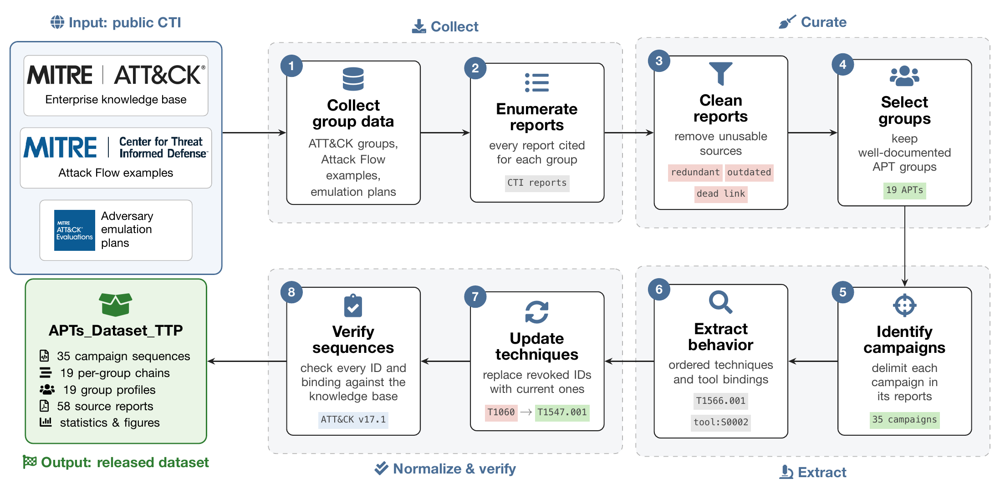
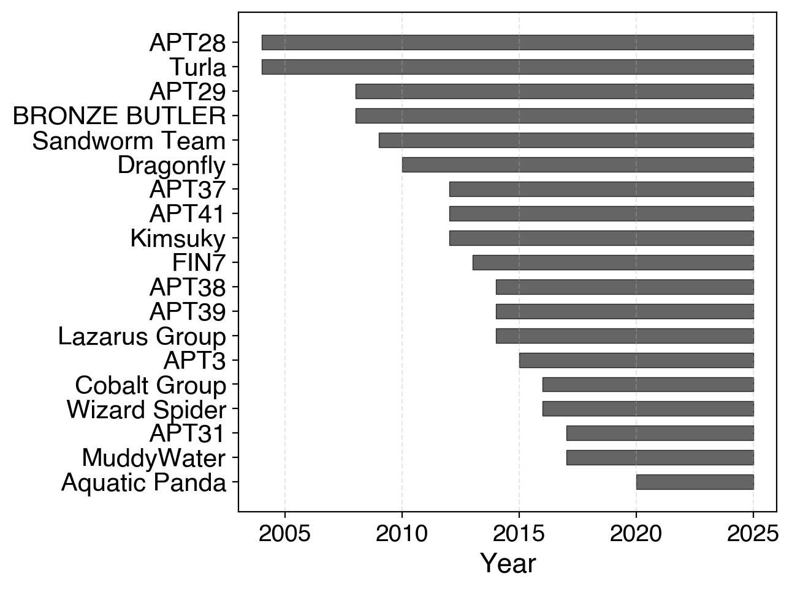
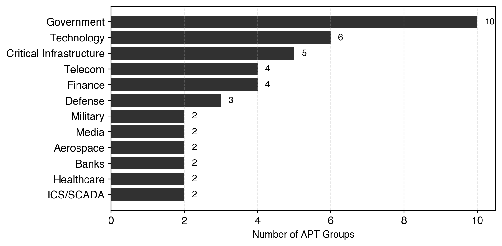
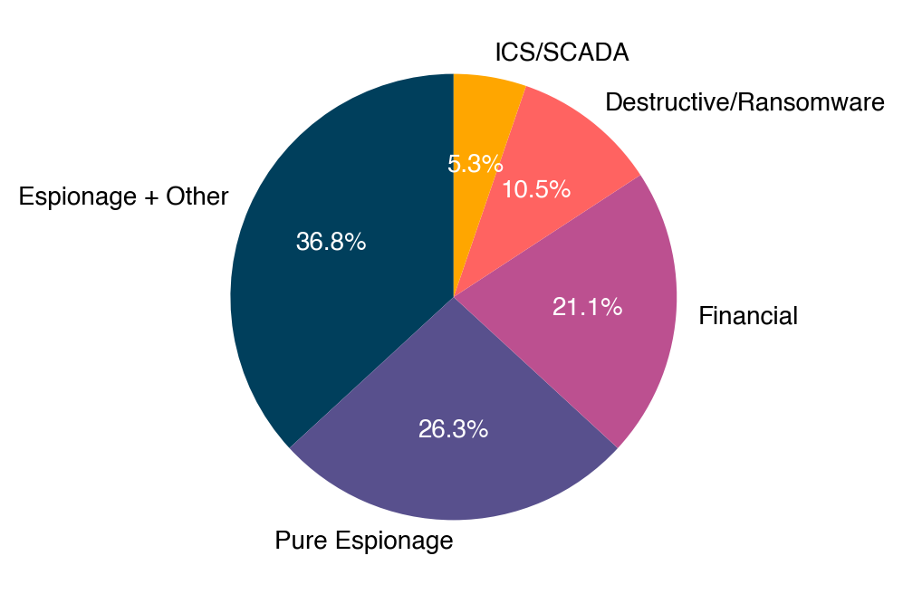
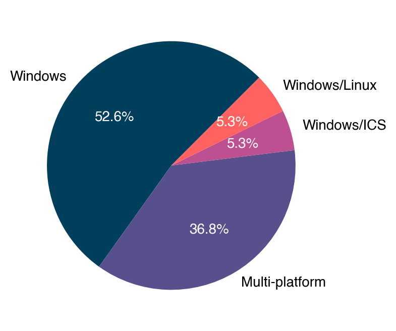
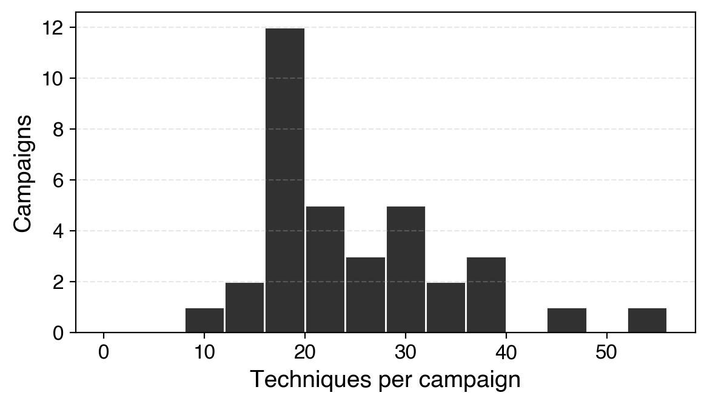

# APTs_Dataset_TTP

Ground-truth MITRE ATT&CK technique sequences for real campaigns of **19 APT groups**, built by hand from public threat-intelligence reports. It is the benchmark used to evaluate ThreatEvolve.

| | |
|---|---|
| APT groups | 19 |
| Campaign sequences | 35 (33 used in the paper) |
| Per-group reference chains | 19 |
| Distinct techniques | 217 |
| Techniques per campaign | 11–53 (median 20) |
| ATT&CK version | Enterprise v17.1 |

## Construction pipeline



1. **Collect group data.** Gather every threat group from MITRE ATT&CK (Enterprise v17.1), the CTID Attack Flow examples and the MITRE Engenuity adversary emulation plans.
2. **Enumerate reports.** List every report that ATT&CK cites for these groups, their campaigns and their software.
3. **Clean reports.** Remove redundant reports, outdated reports and references whose links no longer resolve.
4. **Select groups.** Keep the groups whose activity is documented in enough detail: 19 APT groups.
5. **Identify campaigns.** Delimit individual campaigns within the retained reports.
6. **Extract behavior.** Record the ordered ATT&CK techniques of each campaign, with the tools and malware bound to them.
7. **Update techniques.** Replace techniques revoked in ATT&CK v17.1 with their current equivalents. The original IDs are kept in `replaced_ids`.
8. **Verify sequences.** Check every technique ID and tool binding against ATT&CK v17.1. The result is stored in `attack_v17_1_check`.

## Contents

```
data/
  campaigns.json / .csv     full ordered technique sequence of each campaign
  apt_chains.json / .csv    one consolidated attack chain per APT group
  apt_metadata.csv          group metadata: ATT&CK ID, activity years, objective, sectors, platforms
reports/
  references.csv            source reports for every sequence (URL, Wayback link, local PDF)
  pdfs/<APT>/               PDF copy of every referenced report (58 files)
  open/                     openly licensed sources (CTID Attack Flow files, MITRE APT3 emulation plan)
docs/
  dataset_pipeline.pdf/.png construction pipeline figure
  src/                      figure source (XeLaTeX/TikZ) and source logos
stats/
  make_stats.py             regenerates every table and figure below from data/
  tables/                   counts behind the figures, plus sequence-length and technique-frequency tables
  figures/                  activity timeline, target sectors, objectives, platforms, length distribution
```

## Sequence format

A campaign is an ordered list of **steps**. Each step is a list of ATT&CK technique IDs. A step with more than one technique groups techniques the reports describe at the same stage of the intrusion, either as alternatives or with no reliable order between them.

```json
{
  "id": "APT29/Operation_Ghost",
  "apt": "APT29",
  "attack_group_id": "G0016",
  "campaign": "Operation Ghost",
  "attack_campaign_id": "C0023",
  "sequence": [["T1589.001", "T1585.001"], ["T1583.001"], ["T1587.001"], ["T1566.001"], ...],
  "sequence_str": "{T1589.001,T1585.001} -> T1583.001 -> T1587.001 -> T1566.001 -> ...",
  "n_steps": 20, "n_techniques": 38, "n_unique_techniques": 36,
  "used_in_paper": true,
  "status": "ok",
  "replaced_ids": {"T1060": "T1547.001"},
  "attack_v17_1_check": {"unknown": [], "revoked": {}, "deprecated": []}
}
```

- `used_in_paper`: the campaign is one of the 33 variant-exploration parents (RQ2) in the paper.
- `replaced_ids`: revoked technique IDs replaced in step 7, mapped to their v17.1 replacement. When the replacement was already present in the same step, the duplicate was dropped.
- `attack_v17_1_check`: result of step 8. It lists technique IDs that are unknown, revoked or deprecated in ATT&CK v17.1; empty lists mean the sequence passes.

`apt_chains.json` contains one chain per group: a flat ordered list of techniques. These chains are the ground truth for hypothesis generation from partial observations (RQ1). `annotated_source` keeps the curator's original notation, including tool bindings such as `[tool:S0002]` and free-text notes.

## Sources

The sequences were drawn from three kinds of source:

1. Attack Flow v2 examples from the Center for Threat-Informed Defense (https://ctid.mitre.org/projects/attack-flow-v2/).
2. In-depth public CTI reports from security vendors and research organizations, cited on MITRE ATT&CK group and software pages.
3. MITRE Engenuity adversary emulation plans (https://attackevals.github.io/ael/).

`reports/references.csv` lists the sources for each sequence:

- `origin = attack-v17.1`: the reference is cited by ATT&CK v17.1 for the campaign, group or software involved.
- `origin = web-search`: the campaign is not covered by ATT&CK and the reference was located separately.
- `wayback`: a Wayback Machine lookup link for the URL.
- `verified`: whether the curators have confirmed that this reference is the one the sequence was built from.
- `pdf`: the local copy under `reports/pdfs/<APT>/`.
- `pdf_from`: where the copy was obtained. `live` means the original URL; `wayback` means a Wayback Machine snapshot, used when the original is gone or redirects elsewhere; `migrated` means the article's current address (FireEye research now on the Google Cloud threat-intelligence blog).
- `pdf_url`: the exact address the copy was made from, when it differs from `url`.

Reports published as PDFs are stored unmodified. Reports published as web pages were printed to PDF with headless Chromium after closing cookie dialogs, so their layout differs from the live page. All reports remain the property of their publishers and are included for research reference only.

`reports/open/` holds sources with an explicit open licence:

- CTID Attack Flow files, Apache-2.0 (see `reports/open/attack_flow/LICENSE`)
- the MITRE APT3 adversary emulation plan, approved for public release with unlimited distribution

## Statistics

```bash
pip install matplotlib
python stats/make_stats.py
```

This regenerates `stats/tables/*.csv` and `stats/figures/*` (PDF and PNG).

### Activity period of the 19 groups



The groups span more than two decades, from 2004 (APT28, Turla) to Aquatic Panda (2020).

### Targeted sectors



Top 12 sectors by number of groups. The full list is in `stats/tables/target_sectors.csv`.

### Objectives and platforms

<p>


</p>

| Primary objective | Groups | Share |
|---|---|---|
| Espionage + other goals | 7 | 36.8% |
| Pure espionage | 5 | 26.3% |
| Financial | 4 | 21.1% |
| Destructive / ransomware | 2 | 10.5% |
| ICS / SCADA | 1 | 5.3% |

| Platforms | Groups | Share |
|---|---|---|
| Windows | 10 | 52.6% |
| Multi-platform | 7 | 36.8% |
| Windows / Linux | 1 | 5.3% |
| Windows / ICS | 1 | 5.3% |

### Campaign length



| Set | n | Min | Median | Mean | Max |
|---|---|---|---|---|---|
| Campaigns (techniques) | 35 | 11 | 20 | 24.4 | 53 |
| Campaigns (steps) | 35 | 6 | 14 | 14.5 | 30 |
| Per-group chains (techniques) | 19 | 6 | 11 | 12.0 | 21 |

## Notes

- `APT3/Operation_Clandestine_Fox` and `APT41/World_tour_2021` are not among the 33 campaigns evaluated in the paper (`used_in_paper = false`).

## Citation

If you use this dataset, please cite:

```bibtex
@article{machrouh2026threatevolve,
  title   = {{ThreatEvolve}: {LLM}-Guided Evolutionary Framework for {APT} Hypothesis Exploration},
  author  = {Machrouh, Mohammed and Hamouni, Lahoucine and Berrada, Ismail},
  journal = {IEEE Transactions on Dependable and Secure Computing},
  year    = {2026},
  note    = {Under review}
}
```

## License

- **Dataset** (`data/`, `stats/tables/`, `stats/figures/`, `docs/`): [Creative Commons Attribution 4.0 International (CC BY 4.0)](LICENSE). You may share and adapt it for any purpose, provided you cite the paper above.
- **Code** (`stats/make_stats.py`): [MIT](LICENSE-CODE).
- **Third-party reports** (`reports/pdfs/`): not covered by either licence. Each report remains the property of its publisher and is included only as a reference copy for research.
- **CTID Attack Flow files** (`reports/open/attack_flow/`): Apache-2.0, see the licence file in that folder.
- **Logos** (`docs/src/logos/`): MITRE ATT&CK®, the Center for Threat-Informed Defense and ATT&CK® Evaluations logos are trademarks of The MITRE Corporation. They are used only to identify the data sources and are not covered by the licences above.
